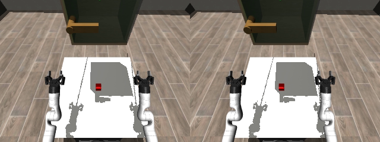

# VR Robosuite



Quest binocular teleoperation for the three SEW-Geometric-Teleop study tasks:
**ExpCabinet**, **ExpGlassGap**, and **ExpHandover**. Both Dual Kinova 3
**Robotiq** and **Psyonic Ability** variants run with robosuite task physics.

The pinned [dual_kinova3_teleop](https://github.com/Euler-Rodrigues-Lab/dual_kinova3_teleop)
submodule supplies robot assets, sample motions and retargeting sessions. Its
nested XRT_devices supplies Quest input, replay, recording, and the reusable
GStreamer RGB publisher. There is no dependency on a local SEW source checkout.

## Setup (Linux)

```bash
git clone --recurse-submodules https://github.com/Euler-Rodrigues-Lab/vr_robosuite.git
cd vr_robosuite
uv sync --python 3.10 --extra mink --extra test
sudo apt-get install gstreamer1.0-tools gstreamer1.0-plugins-base \
  gstreamer1.0-plugins-good gstreamer1.0-plugins-bad gstreamer1.0-plugins-ugly
export MUJOCO_GL=egl
```

The free Dual Kinova wheel is supplied **for pose-mode simulation demos only**.
Anyone may download the official bundle and run it on a compatible computer
with their Quest headset. Redistribution, standalone use, other-environment
use, and physical robot control are prohibited; see the
[wheel license](external/dual_kinova3_teleop/wheels/FREE_DUAL_KINOVA3.md).

`uv sync` installs application dependencies but does **not** install or switch
solver wheels. To explicitly select the bundled Linux x86_64 demo wheel
(Python 3.10+, glibc 2.34+):

```bash
uv sync --extra mink --extra test
uv run geo-kin-provision install --project . \
  --wheel external/dual_kinova3_teleop/wheels/geo_kin-0.1.0-cp310-abi3-manylinux_2_34_x86_64.whl
```

To select your registered full wheel instead, run
`uv run geo-kin-provision install --project .` with your license active.
A **valid dev license always takes priority**, even with the demo build:
dev sessions have full pose/TCP access and no one-minute limit. Your selected
wheel is preserved by subsequent `uv sync` runs. Recreating the virtual
environment requires provisioning it again.

Without a covering dev license, the demo supports **pose mode only** and permits
**one minute per Python process**, starting at the first solver call. Its banner
finishes in 0.5–1 second total. At expiry, solver output stops and the trial
closes with status `demo_expired`, preserving its recording. There is no
automatic cooldown or resume. Resetting or recreating a solver cannot renew the
timer; restart the app for another demonstration. Automating restarts to provide
continuous solver use is prohibited by the license. These restrictions do not
make unauthorized use technically impossible.

The default arm mode is **pose**. Licensed users can select TCP with
`--retarget-mode tcp` (SEW controller). For Robotiq, `gripper_palmbox` has its
origin at the thumb/index fingertip midpoint; +Y runs from thumb to index tip,
+Z points from index MCP toward the midpoint after orthogonalization, and
+X = Y × Z. This targets the robot's actual grasp site, 145 mm beyond its tool
origin. Missing, non-finite, or degenerate landmarks hold the arm. Psyonic TCP
continues to use its mounted index MCP. Pinching to **5 cm or less closes** the
parallel jaws; separating the tips opens them. Missing gripper input holds the
previous command. The initial camera uses SEW's look-down offset even before
head tracking starts.

## Preview and both sample recordings

```bash
uv run vr-robosuite --device idle --no-stream --steps 1 --snapshot cabinet.png
uv run vr-robosuite --device replay --sample picking_up_mustard \
  --variant psyonic --environment ExpGlassGap --no-stream --snapshot mustard.png
uv run vr-robosuite --device replay --sample ipman_roll \
  --variant psyonic --environment ExpHandover --no-stream --snapshot ipman.png
```

Without streaming, these commands render offscreen and save the requested final
image. Omit `--no-stream` after starting MediaMTX to watch in Quest. Both sample
motions come from the submodule; they demonstrate control and are not successful
solutions to the study tasks. Use `--frames PATH` or `--csv PATH` for other inputs.

## Binocular video to Quest

Set the workstation's LAN address (reachable from Quest), then start MediaMTX:

```bash
export STREAM_HOST=192.168.1.100  # replace with your workstation address
docker compose up -d
uv run vr-robosuite --environment ExpCabinet --variant robotiq
```

Alternatively run a native MediaMTX binary with `config/mediamtx.yml`, setting
`MTX_WEBRTCADDITIONALHOSTS` to the same workstation LAN address.

Use the native [XRT-Client](https://github.com/Euler-Rodrigues-Lab/XRT-Client)
Quest application. Set pose signaling to `http://PC_IP:8080/offer`, connect with
**Power**, then press **Play** to start sending tracking. In the FPV/ZEDv2 scene,
connect video to **`http://PC_IP:8889/st`** and select **binocular / separate-eye
mode**. The client requests `/st/left/whep` and `/st/right/whep`; each endpoint
provides only its corresponding eye. For single-stream side-by-side mode, use
the same base address `/st` (the client adds `/whep`). `/stereo` and
`/zed_stereo` remain aliases for the combined side-by-side stream only.
No ZED camera is needed.

Both eyes are rendered from one simulation state. A GStreamer tee crops the
left and right halves of that same frame before H.264 encoding, preserving
source timestamps. MediaMTX receives the combined stream on local UDP 9000,
the left eye on UDP 9002, and the right eye on UDP 9004, then serves WebRTC/WHEP
to Quest. The two WebRTC connections can still experience different network
latency. Defaults are 640×480 per
eye, 30 fps, 65 mm IPD, 75° vertical FOV. Adjust `--width`, `--height`, `--rate`,
`--ipd`, and `--bitrate` for the workstation. Head yaw/pitch follows the source
experiment's camera mapping; `--no-head-tracking` fixes the view. This is stereo
FPV, not a full six-degree-of-freedom VR renderer.

Allow TCP 8080 (tracking), TCP 8889 (WHEP signaling) and UDP 8189 (video) between
Quest and the workstation. The supplied server configuration is for a trusted
local study network. Do not expose it publicly. Tracking and video are separate
connections; removing the headset can pause poses until Play is pressed again.
Task physics pauses when input is missing/stale, while the last scene continues
streaming.

```bash
uv run python scripts/doctor.py
uv run python scripts/check_stream.py --output received.png
docker compose down
```

The receiver check requires a running publisher. See [validation](docs/validation.md)
for the checks actually performed, including the remaining headset check.

## Study sessions

The source pipeline uses two controllers per environment. Codes are
`1=ExpCabinet`, `2=ExpGlassGap`, `3=ExpHandover`; controller codes are
`1=sew_mimic`, `2=mink`. Choose the counterbalancing sequence for each participant:

```bash
uv run vr-study --participant P01 --order 132 --controllers 121221 \
  --variant psyonic --duration 120
```

The 120-second study example requires full access; the free demo stops each
solver process after 60 seconds. This runs six trials, waits for operator Enter between trials, and records an
atomic plan under `recordings/studies/P01`. Repeat the **same command** to resume.
Completed trials are skipped; interrupted/error attempts remain recorded and
are retried in new directories. Changed order, controllers, seed or trial options
require a new participant/output directory. `--plan-only` writes the plan without
launching a trial; `--auto` removes the operator prompt. Use pseudonymous IDs.

Each trial stores `trial.json` (options, package/repository versions and explicit
outcome), `model.xml`, and incremental `trajectory.h5` (qpos, qvel, ctrl, action,
and `[monotonic_time, simulation_time, valid_input]`). Live XR input is recorded
under `input/`. Outcomes distinguish success, timeout, termination, interruption,
source exhaustion, preview, demo expiry and error; missing files never count as task failure.
Use `--env-kwargs '{"log_data":true}'` to additionally enable the source contact
logger; set `VR_ROBOSUITE_CONTACT_DIR` to its desired output directory.

SEW defaults to pose retargeting with tracked elbows, a fixed robot base, and
the hardware-profile self-collision safety filter. Full-access users can select
TCP mode: fingertip-midpoint gripper frames for Robotiq and index MCP for Psyonic. Shoulder relocation is disabled for these fixed-base tasks.
`--no-safety-filter` disables the filter. The MINK option uses the shared MINK
fallback with joint limits; it does **not** apply the Rust safety filter and is
not a numerical reproduction of the old experiment's whole-body MINK controller.
The trial metadata records whether the safety filter is active. Self-collision
filtering does not provide task-object collision avoidance.

## Additional robosuite tasks

```bash
uv run vr-robosuite --plugin YOUR_REGISTRATION_MODULE \
  --environment YOUR_REGISTERED_ENV --env-kwargs '{"YOUR_OPTION": 1}'
```

Modules are imported before `robosuite.make`. Additional tasks must support the
DualKinova3 fixed-base robot and installed robosuite version. This is the extension
point for DexMimicGen; DexMimicGen tasks are not bundled or validated here.

```bash
MUJOCO_GL=egl uv run pytest -q
```

See [third-party notices](THIRD_PARTY_NOTICES.md): the wine glass asset carries
CC BY-NC terms. The binary wheel is bundled in the Dual Kinova submodule with its checksum and demo terms; personal license files are never committed.
